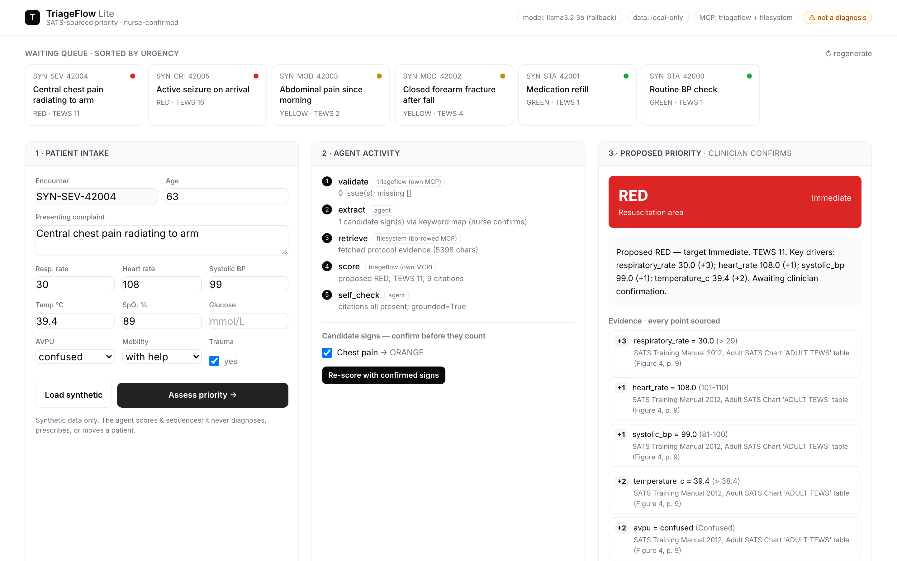

# TriageFlow Lite

**An agentic assistant for the busy OPD triage desk.** It turns a patient's vitals and
presenting complaint into a **sourced SATS priority level** in seconds — so the nurse can
see who needs to be looked at next, backed by the numbers already in front of her.

> **The one rule.** TriageFlow *scores and sequences* — it **never diagnoses, never
> prescribes, and never moves a patient**. A named nurse or clinician confirms every
> priority before it reaches a queue position. Every priority cites the vital or sign
> behind it; an unsourced flag is worse than no flag.

Theme: **Symptom-based priority scoring** · Protocol: **South African Triage Scale (SATS) Adult / TEWS**



<p align="center"><sub>The nurse workspace — intake, the agent's live tool-call trace (own + borrowed MCP), and a sourced priority awaiting clinician confirmation.</sub></p>

---

## Run it (one command)

Prerequisites: [`uv`](https://docs.astral.sh/uv/), Node.js (for `npx`), and
[Ollama](https://ollama.com/download) for the open-weights model.

```bash
uv run triageflow serve
```

Open <http://127.0.0.1:8000>. On first run `uv` installs everything; the app detects
Ollama and offers to download the model. Other commands:

```bash
uv run triageflow doctor        # check Ollama, model, and both MCP servers
uv run triageflow pull-model    # download the open-weights model (self-healing)
uv run triageflow demo          # run one assessment in the terminal, tool calls + approval
uv run python evals/run.py      # run the evaluation suite
uv run python -m pytest         # unit tests (pins the SATS/TEWS table)
```

**No GPU needed.** The clinical priority is computed by deterministic code (instant); the
open-weights model (Qwen2.5-7B-Instruct, fallback Llama-3.2-3B) only extracts candidate
signs from free text and writes the one-line handover. Set `TRIAGEFLOW_NO_LLM=1` to run the
agent fully deterministically (fast demos / LLM-off sites).

### Self-healing model download
If a download fails or is interrupted, click **Clear & re-download** in the UI (or
`uv run triageflow pull-model --force-clean`). It wipes partial blobs and a broken manifest,
then re-pulls cleanly — a bad download can never wedge the app.

---

## What it does (the workflow it serves)

**Facility:** a public hospital outpatient department. **User:** the triage nurse at the
single desk that everyone passes through before they are assigned a priority.

She loads a patient (or picks one from the waiting queue), enters the presenting complaint
and the vitals she just measured, and clicks **Assess**. The agent then, visibly:

1. **validates** the input (missing / implausible / stale / contradictory / wrong-unit),
2. **extracts** candidate SATS signs from the free text — *for her to confirm*,
3. **retrieves** the cited protocol text from the borrowed filesystem MCP,
4. **scores** the SATS priority deterministically (TEWS + discriminators),
5. **checks itself** — confirms every point is cited and grounded in the protocol,
6. **pauses at the approval gate** — nothing is queued until she approves or overrides.

If a waiting patient is re-checked and has worsened, the agent raises a **deterioration
flag** for a second look — it still cannot move them.

The result is a priority a nurse can defend in a clinical audit: a colour band, a target
time, and every contributing vital/sign with its SATS citation — plus a readable, append-only
audit log of every tool call and the named approval.

---

## Documentation

| Doc | What's in it |
|-----|--------------|
| [ARCHITECTURE.md](ARCHITECTURE.md) | Agent shape, nodes, MCP built-vs-borrowed, control/cost/residency |
| [docs/MCP.md](docs/MCP.md) | The two MCP servers, full tool catalog + schemas, call logic |
| [docs/DATA.md](docs/DATA.md) | **Stakeholder data card** — how synthetic data is generated, explainability & trust, limitations |
| [EVALS.md](EVALS.md) | 10 test tasks, pass/fail, determinism, the documented unfixed failure |
| [DESCRIPTION.md](DESCRIPTION.md) | ~300-word summary (theme, facility, workflow) |
| [docs/DEMO.md](docs/DEMO.md) | <3-min demo script |
| [CONTRIBUTING.md](CONTRIBUTING.md) · [SECURITY.md](SECURITY.md) · [CODE_OF_CONDUCT.md](CODE_OF_CONDUCT.md) | Contributor guide, privacy/disclosure policy, conduct |

## Architecture (short)

A **LangGraph** state machine with tool-calling nodes — a predictable workflow, not a
free-running multi-agent loop. See [ARCHITECTURE.md](ARCHITECTURE.md).

- **Own MCP server** (`triageflow`): `validate_triage_input`, `score_triage`,
  `check_deterioration`, `request_clinician_approval`, `suggest_discriminators` — every
  call audit-logged.
- **Borrowed MCP server**: the official
  [`@modelcontextprotocol/server-filesystem`](https://github.com/modelcontextprotocol/servers),
  read-only over `protocols/`, serving the cited SATS text. *Why borrow:* sandboxed,
  path-traversal-safe file access is a solved problem — reusing the reference is safer and
  faster than writing our own.
- **Open-weights model** via locally-managed Ollama — patient data never leaves the machine.

## Data

Synthetic only, and **FHIR R4-shaped** (see `src/triageflow/data/`): vitals carry **LOINC**
codes so an encounter looks like what a real EMR/FHIR API returns. We deliberately **do not
use SNOMED CT** (its Affiliate licence carries fees in non-member countries — an eligibility
risk) or real datasets like MIMIC (de-identified real data + out-of-country residency). A
reproducible generator produces the waiting queue and a deterioration series.

## Safety & limitations

- Adult pathway only (>12y / >150cm). Paediatric SATS is out of scope for this version.
- The free-text sign extractor can miss or over-suggest; candidates **never** affect the
  score until the nurse confirms them (see the documented failure in [EVALS.md](EVALS.md)).
- Not a medical device. Thresholds are a re-encoding of a published scale and must be
  clinically reviewed before any real use.

## Licence & attribution

Code: **Apache-2.0** (see [LICENSE](LICENSE)). The SATS Adult rules are a fact-based
re-encoding of the **South African Triage Scale** (*SATS Training Manual 2012*, South
African Triage Group / EMSSA, CC BY-NC-SA 3.0); this repo ships only the re-encoded
thresholds with attribution, not the copyrighted charts. See [NOTICE](NOTICE).
